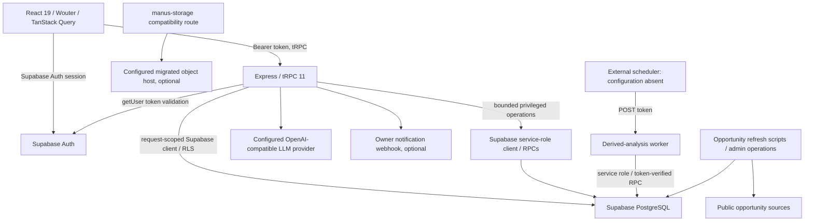

# PathPilot architecture

Verified from source at commit a5104b1 and updated during the approved source migration on 2026-09-07. Supersedes this file's obsolete Manus OAuth / MySQL description.

## Source boundaries

- `client/src`: React 19, TypeScript, Tailwind 4, Radix/shadcn components, Wouter routing. `App.tsx` lazily loads public, auth, onboarding, workspace, shared report, and public portfolio routes. React Query and tRPC handle server data; Supabase manages browser sessions.
- `server/_core/index.ts`: Express entry point; JSON/urlencoded parsers; `/api/trpc`; `/api/scheduled/derived-analysis`; `/manus-storage/*`; Vite middleware in development and built SPA files in production.
- `server/_core/context.ts`, `trpc.ts`, `server/supabase.ts`: bearer-token validation, protected/admin procedures, request-specific clients using AsyncLocalStorage. Admin role comes from `app_metadata`, not editable user metadata.
- `server/routers/pathpilot.ts`: product API. `server/db.ts` accesses Supabase tables; user data operations run under authenticated RLS. Limited service-role operations include shared catalog and explicitly privileged/public RPC boundaries. Preserve their validation.
- `server/simulation`, `roadmap`, `dashboard`, `opportunities`: deterministic career graphs, behavioral evidence, recommendations, dashboard signals, external opportunity catalog fetch/normalization.
- `server/_core/llm.ts`: configured OpenAI-compatible chat adapter; consumed by career discovery, roadmap generation, mentor, and project guidance. Structured results are validated before persistence. Cache and rate limits reduce repeated AI work.
- `supabase/migrations`: PostgreSQL tables, policies, grants, indexes, catalog data, and RPCs. Auth users live in Supabase's `auth.users`; application rows use UUID ownership and cascade relationships.
- `drizzle`: legacy MySQL definitions and migrations. These are not the active application's database layer.
- `tests` and `server/*.test.ts`: Vitest Node tests; many pure unit/source-boundary checks plus three live Supabase integration files.

## Data flow and safety

A user signs in through Supabase. The browser attaches the session bearer token to tRPC calls. The server validates it with Supabase Auth and creates a client carrying that token. Protected procedures establish a request-local client and scope operations to the user, with PostgreSQL RLS as an additional boundary. Career and mentor requests assemble bounded context, apply rate limiting and validation, invoke the configured AI provider, and persist results. Adaptive simulation logic primarily runs in the application using versioned graphs.

Public portfolios and report links have separate publication/token boundaries. Account deletion uses a privileged database helper and explicit UI confirmation. Derived analysis queues records; the HTTP worker invokes a token-checked SQL RPC via a service-role client. Deployment must provide an external trigger; no checked-in cron registration establishes one.

## Build, assets and operations

Vite outputs `dist/public`; esbuild bundles the Express entry to `dist/index.js` with packages external. Vite and its config are loaded dynamically only when the development middleware starts, so production startup does not need to execute Vite.

Public assets are `client/public` (robots and sitemap); Google Fonts loads externally. No uploaded binary asset collection or Supabase bucket provisioning is checked in. The storage compatibility route remains active for historical `/manus-storage/*` URLs and redirects to `STORAGE_PUBLIC_BASE_URL` when configured. The `@assets` alias points to an absent `attached_assets` directory.

Logging uses console calls. HTTP/tRPC boundaries return application errors; some server logging includes raw upstream errors and needs redaction review. No Docker, CI workflow, deployment manifest, Python service, or scheduler configuration is checked in. See the audit for verification limits and migration steps.
