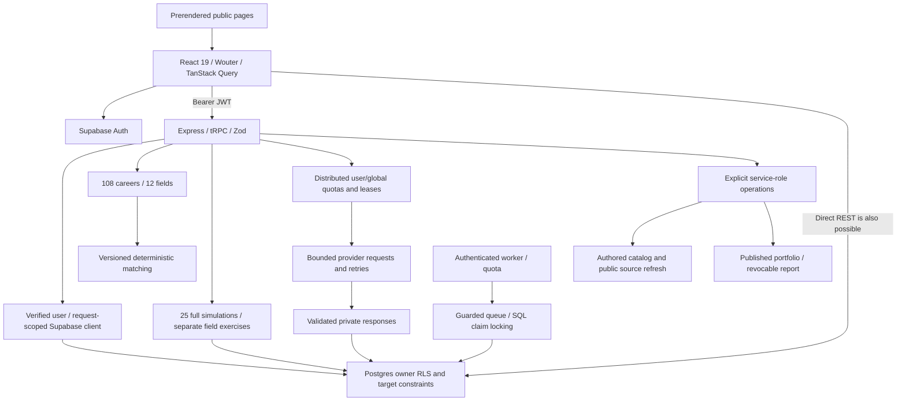

# PathPilot comprehensive architecture audit

Date: 2026-11-05. Repository: `PathPilot-marketing-review`. Branch: `codex/complete-overview-audiences`; HEAD `f67a26329c074d1ab0b5427f9a8d4f4bece73fbc` plus accumulated uncommitted work. References below are working-tree line numbers, not production references.

## Executive assessment

**Suitable for controlled staging evaluation; not approved for public student release.** The React/Express/Supabase modular monolith is a reasonable architecture for this product. A framework rewrite is not warranted. The major concerns are transactional reliability, gaps between application validation/admission and direct database access, assessment-like presentation, and incomplete authenticated acceptance testing.

No critical exploit was established. This is not a penetration-test certification or legal compliance determination. Existing security work materially improves request ownership, RLS, safe Markdown, provider limits and simulation concurrency; preserve it.

The review traced public routing, intake, matching, simulations, opportunity sources/search, roadmap/recommendations, goals/projects, Mentor, sharing, authentication, quotas/workers, migration strategy, tests and builds. It is a cross-system flow audit, not a claim to have reviewed every dependency or every line of all 405 source/test/migration files. Findings distinguish verified code behavior, risks needing reproduction, and prior hosted evidence.

## Running application and handoff

- **URL:** http://127.0.0.1:3055/ ; login/registration: http://127.0.0.1:3055/auth . The full Express/Vite application is running, bound only to loopback. No public tunnel or deployment.
- Existing process PID 38065 remained listening on resume. No restart or termination. Temporary launcher `/private/tmp/pathpilot-local-staging.mjs` was inspected, not modified in this resume. It clears inherited Supabase/client/provider settings, verifies staging identity, retrieves keys into memory, and binds `127.0.0.1`.
- Staging: `pathpilot-staging`, `qekwtncqujusgkjeabyp`, organization `ucxtorsbwsxvfyaemhks`. Production reference is different: `tivwzzstewybodmwhhxg`. No production data/configuration accessed.
- Fresh resume check of the Vite-served Supabase client module returned HTTP 200 and **only** `https://qekwtncqujusgkjeabyp.supabase.co` as its Supabase hostname. No keys were printed. The server's existing startup verification and inspected launcher select the same staging target; no process-memory secret dump was used.
- Email signup is enabled and confirmation is required (prior live Auth settings read). Register personally with an owner-controlled test inbox and synthetic profile details, confirm email, then sign in. Do not assume old automated test accounts remain: they were cleaned up.
- During the resumed audit the user independently signed in. The original tab was observed on authenticated Discovery and left untouched. Separate-tab checks below use that staging session; the agent did not create an account or enter credentials. This establishes current authenticated rendering, not proof of every registration/confirmation step.
- Email delivery and callback allowlisting remain unverified. If needed, the owner must add `http://127.0.0.1:3055/auth` and `http://127.0.0.1:3055/auth/update-password` to **staging-only** Auth redirect URLs. Application constructs same-origin redirects in `client/src/lib/auth-redirect.ts:3`. Do not disable confirmation or modify production.
- AI provider credentials are intentionally absent. Missing server-side configuration: `LLM_API_KEY` or `OPENAI_API_KEY`; optional base/model through `LLM_API_BASE_URL`/`LLM_MODEL` (or OpenAI aliases), per `server/_core/env.ts:5–10`. Never use a VITE-prefixed secret. The current launcher explicitly clears provider credentials, so merely exporting a key will not enable AI; a separately approved secure launcher/configuration update and restart is needed. Do not paste secrets in chat.
- No worker scheduler credential or notification/storage integration was provisioned. The local process-random quota signing secret is not a suitable shared secret for multiple deployed instances.

## Architecture

### System boundaries

| Area | Implementation | Assessment |
|---|---|---|
| Routes/rendering | `client/src/App.tsx:36–67`, `shared/public-seo.ts`, `client/src/seo/prerender.tsx`, `scripts/prerender-public.mjs`, `server/_core/vite.ts`, `vercel.json` | Public prerender + lazy React routes; private shell; production parity requires deployment evidence. |
| Authentication | `client/src/lib/supabase.ts`, `client/src/main.tsx:24–80`, `server/_core/context.ts`, `server/_core/trpc.ts`, `server/supabase.ts` | Auth getUser, server-derived identity, request-local JWT client, identity-scoped query cache. Service role only at explicit privileged boundaries. |
| Intake | `pages/Onboarding.tsx`, `shared/discovery-intake.ts:6–33`, `db.ts:77–80` | Five steps, explicit draft saving, strict application schemas and safe legacy parsing. Direct DB contract weaker. |
| Discovery | `CareerExplorer.tsx:15–77`, `StartingFields.tsx`, shared taxonomy/matching | 108 careers, 12 fields, four starting-field suggestions; complete catalogue stays accessible. Comparison edits/exercises are explicitly screen-local, not persisted profile edits. |
| Simulations | `server/simulation/*`, `shared/simulation-work.ts`, `AdaptiveSimulation.tsx`, `SimulationWorkbench.tsx`, `db.ts:249–293` | Declarative authored work and deterministic transitions. Stable 25-ID full-simulation allowlist separate from field samples. Previous-node/status predicate rejects stale submissions. |
| Opportunities | `pages/Opportunities.tsx`, `server/opportunities/*`, `db.ts:96–179`, search RPC | Source-backed IDs, paginated filtering, broad 12-field and legacy-tag alignment; no listings invented by matching. |
| Roadmap | `RoadmapExperience.tsx`, `routers/pathpilot.ts:496–565`, `server/roadmap/*`, `db.ts:236–238` | Career resolver, user confirmation and validated milestones; transaction boundary inadequate. |
| Goals/projects | Workspace, project/goal routes, `db.ts:233–234,311,418` | Owned rows and linked-target RLS; multi-write reliability and pagination need follow-up. |
| Mentor | `mentor-context.ts`, `routers/pathpilot.ts:620–670`, `ai/provider-request.ts`, `rate-limit.ts` | Bounded selective context and goal-reference allowlist; output validation; retry/action consistency needs work. |
| Worker/cache | `derived-analysis.ts`, handler, `ai-result-cache.ts` | Guarded queue claims; owner-keyed versioned cache; quotas are not a substitute for queue locking or direct-REST admission. |
| Sharing | `report-share.ts`, portfolio routes, account deletion | Explicit publication and expiring/revocable random capability; user deletion/cascades do not settle backup/provider retention. |

## Findings and remediation

### Critical

None established. Production secrets, RLS and schema were not verified; this does not establish absence of critical production issues.

### High

**H1 — Nontransactional roadmap replacement and recommendation acceptance. VERIFIED code sequence; hosted failure injection not performed.**

References: `server/db.ts:237–238`; `server/routers/pathpilot.ts:505–550`; `server/roadmap/recommendation-repository.ts:162–185`.

Flow: authenticated generate/create resolves career, loads owned profile/plan, checks career-change confirmation; generation applies AI admission, parses nine year/category milestones; both routes call `createRoadmap`. That repository function (1) archives all active owned roadmaps, (2) inserts replacement, (3) inserts milestones, (4) reads the resulting active plan. Failure at (1) stops inserts; failure at (2) leaves the old plan archived; failure at (3) leaves an active plan without its milestones; failure at (4) reports failure after successful writes. There is no rollback. Concurrent requests can interleave despite per-AI-operation admission; the manual create path and recommendation acceptance also call this function.

Acceptance additionally creates a goal/activity, creates or appends to a roadmap, then updates recommendation status. Its final update lacks a pending-status compare-and-swap. A retry after partial failure can duplicate a goal/milestone. Progress updates separately write a milestone, calculate aggregate progress and update roadmap/activity, allowing stale aggregates.

Reproduce safely with injected repository transport failures at each statement, not destructive hosted tests. Impact: lost active-plan pointer, partial plans, duplicate work and misleading retry errors; archived records are not deleted.

Resume evidence: `tests/roadmap-failure-audit.test.ts:1–70` now exercises the actual repository with an offline Supabase transport: archive failure stops inserts and retains the active row; replacement failure leaves the old row archived; milestone failure leaves a new active row without milestones. All3 tests passed. These characterize the defect, not a fixed atomicity guarantee. When the transaction is implemented, replace residual-state assertions with rollback assertions and add real SQL concurrency tests.

Recommended forward change (requires reviewed schema/API rollout, not a small audit edit): an owner-scoped `SECURITY INVOKER` RPC derives `auth.uid()`, locks a per-owner key, validates the canonical target and bounded milestones, checks expected active-plan identity/confirmation, and performs archive/insert/milestones/return within one transaction. Add a request-id contract for retry idempotency. Recommendation acceptance needs its own transaction with pending-state lock, goal/milestone creation and final status. Test insert failure rollback, malformed milestone, stale confirmation, two replacements, duplicate request and cross-owner calls using independent connections. Do not use a compensating archive/unarchive sequence as a substitute for atomicity.

**H2 — Database intake accepts malformed nested/oversized owner payloads. VERIFIED schema gap and prior SQL/hosted evidence.**

References: `supabase/migrations/20261031_discovery_intake.sql:3–11`, `shared/discovery-intake.ts:6–33`, `docs/STAGING_READINESS_REPORT.md:104`.

Application: strict top-level object; version literal; fields max12 canonical enums; preferences only known dimensions with 0/0.5/1; motivations max9; subjects/careers max12 strings of 1–80 characters; pathways max7; direction open/ideas. Profile arrays bounded, unexpected keys rejected. Database: NULL or JSON object with version only. Thus versioned objects with wrong nested types, unknown keys, oversized arrays/text or unexpected preferences can be saved through the owner's REST session. `readIntake` safely returns null for invalid shapes, but this is not storage validation. Ownership isolation does not imply payload validity.

Impact: owner data corruption/ignored answers and avoidable storage/processing load; no demonstrated cross-user access. Reproduction: local SQL verifier already tests a versioned malformed preferences object; prior staging report records the same boundary. No new bad rows were written in this audit.

Design: add a new forward immutable validator with explicit allowed keys, type checks before array expansion/casts, known enums, numeric preference domain and all application count/string bounds. Accept NULL and omitted fields that Zod defaults. Define a serialized JSON byte ceiling from measured worst-case valid Unicode payloads with margin, not an arbitrary bound that rejects valid entries. Apply equivalent limits to draft payloads. Test JSON null versus SQL NULL, object/array/scalar, unknown nested keys, Unicode, maximum valid input and legacy rows. Preflight invalid rows by counts only; do not log student payloads or silently rewrite/delete them. Add CHECK NOT VALID to protect new writes, then validate only after approved remediation of legacy invalid rows. Run parity tests through real owner REST. Preserve RLS and historical migration bytes. No migration applied or created in this audit pending contract review.

**H3 — Application quota coverage is not database-wide admission. VERIFIED architectural gap; capacity risk unmeasured.**

References: `server/endpoint-quotas.ts:25–49`, `server/derived-analysis.ts:35–61`, `supabase/migrations/20261026_security_ownership.sql:49–68`, security report current coverage table.

Direct owner REST queue insertion/retry and published anonymous portfolio reads bypass Express quota guards. Queue trigger normalizes transitions and active-job uniqueness/global worker cap help, but do not create per-owner database admission. Reproduce with authorized staging JWT REST requests and two app processes after approving a bounded load plan. Recommend reviewed DB/perimeter controls; preserve ordinary reads and fail narrowly for optional expensive work. Do not mistake one-process fake-store tests for multi-instance proof.

**H4 — Student privacy/governance release gate remains unresolved. VERIFIED product omissions, not a legal violation finding.**

References: `client/src/pages/Privacy.tsx:27–43`, `client/src/pages/Auth.tsx:31–37`.

No in-app age/parent-consent process; provider retention/training and backup retention are not a concrete product contract. Isolation and disclaimers do not settle school authorization, age eligibility, provider agreements or deletion/incident processes. Owner/district/legal review must define permitted audience, lawful school roles, notices, consent when needed, AI data handling, retention and access/deletion procedures. Do not collect DOB or build consent gates without the approved policy. No FERPA/COPPA compliance claim is made.

### Medium

**M1 — Dashboard readiness label conflates matching with preparedness. VERIFIED.** `server/db.ts:471` computes 45% roadmap completion +20% goal completion ratio +25% top match score +up to10% simulation compatibility. `client/src/pages/Workspace.tsx:629–646` displays “PathPilot readiness” and “Readiness”. Changing match score alone changes readiness without completed work. Replace with explicit completed/total milestone and goal counts, or a clearly explained planning-progress metric excluding match/compatibility scores. No validated college-readiness score exists here. Requires product decision; not silently relabeled during audit.

**M2 — Mentor actions and persistence are not atomic/idempotent. VERIFIED sequence; adversarial exploitation not demonstrated.** `routers/pathpilot.ts:638–661` saves question before provider, can update goal before reply save. Failure/retry can leave unanswered duplicates or a changed goal with an error response. The goal-reference allowlist protects ownership; the instruction “only when explicitly asked” is a model prompt, not an independent server confirmation. Use separate proposed/confirmed actions, request IDs and transactional result/action recording. Test hostile reference text, provider failures and each persistence boundary.

**M3 — Large, loosely typed integration modules. VERIFIED maintenance risk.** `Workspace.tsx:1–2107`, `db.ts:1–471`, `routers/pathpilot.ts:1–732` combine many domains, with compressed one-line repository functions and numerous row `any` casts. Extract typed domain repositories incrementally, preserving API contracts. Avoid a wholesale framework rewrite.

**M4 — Unbounded list/history reads. VERIFIED query shape; scale impact unmeasured.** `db.ts:297` reads complete conversation; `db.ts:311` projects/relations; `db.ts:471` dashboard lists; `roadmap/recommendation-repository.ts:36–48` recommendations/context. Bounded prompt history does not bound browser history payloads. Add cursor pagination and aggregate summaries; measure query plans on representative synthetic volumes before adding speculative indexes.

**M5 — Field defaults and opportunity mappings are coarse. VERIFIED limitation.** `shared/career-taxonomy.ts:180–188` assigns shared field work-style/environment weights and pending counselor review. `server/opportunities/career-alignment.ts:6–16` maps healthcare→science, trades→engineering, education/public service→social-impact. These are broad subject connections, not occupation suitability. Exact IDs/names across all12 fields are covered by integration tests; an empty catalogue segment is not filled with fake results. Actual sources are primarily STEM/hackathon/research directories (`curated-catalog-source.ts`, NASA/BNL adapters). No hosted per-field inventory count was performed; hospitality, trades, transport and sport supply is not established. Add real sources and reviewed occupation metadata; keep eligibility/date checks and useful empty states.

**M6 — Onboarding navigation can abandon unsaved/pending answers. VERIFIED source affordance; authenticated browser reproduction pending.** `Onboarding.tsx:24–45` save lock disables form/actions but Back to Discovery remains an external link outside that lock. Browser Back/refresh is not guarded. Explicit-save copy is honest, but add dirty/pending navigation handling and test retry/navigation with real sessions. No claim of continuous autosave.

**M7 — Large formatter chunks and development dependency findings. VERIFIED build size; advisory freshness unverified.** `RichMentorMessage.tsx:1–10` imports Streamdown. Prior current-tree build emits RichMentorMessage882.53kB, emacs-lisp779.85kB and cynefin687.91kB chunks (minified). Lazy loading protects initial pages, not first Mentor use. Limit grammars/diagrams based on usage, measure cold/warm mobile performance. Security report records test-stack critical/high advisories; no fresh registry audit in this resume, so do not treat that historical snapshot as current. Validate upgrade separately; never expose test UI publicly.

**M8 — Leaked-password protection unresolved. Prior hosted warning, NOT freshly rechecked.** `docs/STAGING_READINESS_REPORT.md:19` records disabled protection. `Auth.tsx:13,35` client12-character minimum does not establish server Auth policy. Owner must review supported plan/settings, server minimum length, confirmation/recovery and compromised-password rejection in disposable staging. No settings changed.

**M9 — Direct Settings navigation rendered blank. VERIFIED AND FIXED locally.** `client/src/pages/Workspace.tsx:308–324,408–411`: Settings uses the profile query, not the dashboard query, but previously its render branch was inside `dashboard.data ? ... : null`. A fresh authenticated `/app/settings` tab showed only the shell and Settings breadcrumb with no heading/content; no console exception. Moved `<SettingsView />` ahead of the dashboard gate and removed its old map entry. No authentication, profile mutation or deletion logic changed. `tests/workspace-settings-routing.test.ts` failed before the fix (1 failed/1 passed) and passed afterwards (2 passed). Browser direct refresh now displays Settings plus Profile information, Danger Zone and Resources & Legal. The test is explicitly a source-contract/data-policy check, supplemented by the actual signed-in browser reproduction, not an end-to-end substitute.

### Low

**L1 — CSP is partial defense-in-depth. VERIFIED.** `server/http-security.ts:8–16` restricts base/object/frame but has no script/default/connect allowlist. Safe Markdown/React escaping mitigate specific paths; no XSS exploit established. Develop report-only nonce/hash CSP with build/prerender tests before enforcing.

**L2 — Mentor context depends on current-message keywords. VERIFIED design limitation.** `server/mentor-context.ts:54–75` can omit context for vague follow-ups. Test a scripted conversation before broadening private context; do not load all student records as a shortcut.

**L3 — Historical evidence is easy to misread. VERIFIED docs issue.** `STAGING_READINESS_REPORT.md:31–50` retains older BLOCKED entries under newer passing hosted evidence. Keep historical evidence but add release manifest keyed to source/build/migration identity. Test counts alone are not deployment identity.

### Informational / protections to retain

- `db.ts:289–291` compares current node and in-progress status on simulation update: suspected unconditional progression race is not present. Optional timing is not authoritative progression.
- `mentor-context.ts:5–14` bounds lists/text; history read limited6; request-owned context excludes raw decisions/internal IDs. Tests verify repository owner filters, not live provider behavior.
- `ai/provider-request.ts:68–114` charges every attempt, bounds time/bytes/retries and respects Retry-After. Quota backend errors do not silently permit unlimited provider calls. Request quotas are not spend guarantees.
- `RichMentorMessage.tsx:5–19` removes raw HTML and automatic remote images; links limited to safe HTTP(S). `report-share.ts:3–29` uses random hashed seven-day revocable tokens.
- `CareerExplorer.tsx:15–77` keeps all108 careers accessible, with12 fields and25 full simulations clearly distinct from field exercises. Local overrides are labeled screen-only. No destination restriction from starting recommendations.

## Database, migrations and ownership

The35-file historical sequence has duplicate date versions, dependency-order violations, absent dashboard function revoke and wrong policy-name assumption. `docs/STAGING_MIGRATION_AUDIT.md` inventories every edge/conflict. The deterministic staging compiler retains all sources, checks hashes, adapts only documented cases, guards empty targets and applies atomically with a private ledger. Repeated identical initialization is a no-op, not schema-drift detection. **Never replay this baseline over production.** Existing installations require reviewed forward reconciliation.

Prior hosted evidence:26 public tables with RLS,35 ledger entries,72 assertions plus2 account cleanup checks; A/B JWT REST and independent SQL-role ownership. This resume does not repeat hosted writes or claim fresh cross-account results. Restrictive target-owner policies cover project-goal, message-conversation, guidance-project and recommendation relationships; service-only RPC grants and hardened search paths are important. Owner predicates do not enforce payload quality/admission.

Existing foreign-key indexes and opportunity full-text search are sensible. No production EXPLAIN, load/backup/restore testing or complete schema-drift comparison was done. Transactionality is the demonstrated correctness problem; index additions need measured query evidence.

## Security and privacy assessment

| Threat | Controls observed | Residual verification |
|---|---|---|
| Authorization/IDOR | Auth getUser, session-derived user, scoped client, owner and linked-target RLS | Production parity; complete authenticated browser→API→DB chain; service key protection |
| CSRF/session | Bearer authorization, cross-site mutation guard, identity-aware query cache | Token exposure if same-origin XSS succeeds; real account switching and deleted-token behavior |
| Injection | Parameterized Supabase queries/RPC, Zod bounds, safe Markdown | No exhaustive SQL/dependency proof; CSP and adversarial browser cases |
| Prompt injection | Context as data, explicit output schema, allowlisted goal references | Model instructions not a safety guarantee; user confirmation for proposed mutations |
| Abuse | Bounded ingress, distributed quotas/leases, worker guard | Direct REST, multiple processes, school NAT contention, dollars/tokens |
| Privacy | Private defaults, deliberate publication/revocation, deletion cascades | Age/school consent, provider terms, retention, exports, incident response |

Official sources consulted in the preceding audit: [FTC COPPA FAQ](https://www.ftc.gov/business-guidance/resources/complying-coppa-frequently-asked-questions), [US Department of Education education technology privacy](https://studentprivacy.ed.gov/privacy-and-education-technology), [Supabase password security](https://supabase.com/docs/guides/auth/password-security). These support review topics, not a legal conclusion. School consent is not blanket authorization for unrelated commercial data use. Provider/retention agreements require specific review.

## Verification ledger and testing quality

The previous completed local run was checked against actual logs on resume. After adding the3 offline characterization tests, the full suite and type-check were run again:

| Check | Actual evidence |
|---|---|
| Offline regression |**705 passed /129 suites**, `/private/tmp/pathpilot-audit-final-offline.log`,8.51s after Settings fix. Prior700/127 baseline preserved. |
| Focused new tests |**5 passed /2 suites**, `/private/tmp/pathpilot-audit-final-focused.log`;3 failure-characterization tests and2 Settings tests. Settings pre-fix run intentionally reproduced1 failure/1 pass (`pathpilot-settings-before.log`). |
| Type-check |Final run uses `/private/tmp/pathpilot-audit-final-types.log`. Initial post-fix attempt hit sandbox EPERM writing TypeScript incremental cache; approved rerun required. |
| Production build |Fresh `/private/tmp/pathpilot-audit-final-build.log`: success,12 public pages,548.2kB server bundle; chunk warnings retained. |
| Generated HTML |Fresh verifier passed12 public documents and private shell after Settings fix. |
| Secret scan |Fresh542 repository files +485 browser build files,0 pattern findings; not proof no unknown secret exists. |
| Diff check |Fresh `git diff --check` exit0. Index remains empty. |
| Focused integration |Prior log45 tests /7 suites; included in700 regression run. |
| Current runtime |Loopback listener remains; served browser Supabase hostname verified staging; sign-in and registration render. No account submitted. |
| Prior browser checks |Home, three audiences, resources, simulations intro; signed-out gates; home/Auth320px no horizontal overflow; no captured console errors. |
| Resumed browser checks |Registration form without submission; settings/dashboard/goals/portfolio signed-out gates; schools/privacy/terms/support/accessibility/404 rendering; no captured console errors. Opportunity sample unmatched query→0 with useful empty message, clear→4, Research→1 Brookhaven listing, alignment toggle remains usable. |
| Authenticated browser checks |User signed in independently. Read-only checks rendered Discovery, Roadmap, simulation picker, Opportunities, goals, portfolio/projects, dashboard, Mentor shell and saved onboarding form. Settings initially blank, fixed and verified on refresh. Search found Chef/Pastry Chef, Electrician, Registered Nurse and Teacher across fields. Four starting-field panels and108 catalogue count visible. No answers saved, simulation launched, Mentor message sent or deletion exercised. Opening Mentor may initialize its conversation through its existing GET handler. |
| Responsive limit |Attempted320px override did not affect the separate review tab: all measured widths remained1280px. Therefore authenticated320px coverage is NOT VERIFIED. Override reset; prior Home/Auth320px evidence remains separate. |
| Private API |Prior unauthenticated profile request401/UNAUTHORIZED/no-store. |
| Hosted RLS |Historical72-assertion run only; no fresh hosted isolation claim. |

Default Vitest excludes live suites with disposable guards. Many tests meaningfully exercise schemas, deterministic scoring, provider retries and SQL-role harnesses, but SSR/source-contract and mocked query-filter tests cannot prove focus, timing, RLS deployment or actual save/restore. CI workflow exists but dirty-tree remote execution is not established. No linter configured. Add authenticated browser tests, independent-connection concurrency and failure-injection transaction tests. Preserve failing evidence rather than weakening expectations.

## Performance, accessibility and product assessment

Strengths: lazy routes/components, paginated opportunity RPC, parallel bounded Mentor context, cache versioning, shared design tokens/touch targets, source-linked listings and explicit example labels. Risks: unbounded dashboard/history lists, formatter chunks, multiple provider retries within40s, added quota RPC latency, weakly typed large modules. No P95/SLO or production-scale claims.

Five-step explicit intake gathers useful context without requiring college or prior experience. Four starting fields use the same matching engine;108 careers remain browsable and25 full simulations distinct. Field defaults and pending counselor review limit occupational specificity. Broad opportunity tags need real non-STEM sources. Dashboard readiness conflicts with the product's otherwise careful non-predictive language. Public software-heavy examples underrepresent the expanded catalogue.

Prior320px Home/Auth inspection passed; this is not a full WCAG, screen-reader, dark-theme or authenticated responsive audit. Those checks remain in the manual plan.

## Prioritized release sequence

1. User completes staging email-confirmed login; owner verifies callbacks and approves secure staging provider configuration. Finish authenticated manual checklist.
2. Review and implement H1 transaction/idempotency contract and H2 forward validation migration with compatibility/failure tests. Decide H3 DB/perimeter admission design; test separate app instances.
3. Remove/reframe readiness; resolve student privacy/age/school/provider/retention policy and leaked-password protection decision.
4. Confirm Mentor actions explicitly and test retry/partial-save recovery; verify simulations→roadmap→project→goal chain and account switching.
5. Steven provides correct Vercel team/project access or a reviewed Preview with staging-only variables. Record deployment ID, source snapshot and migration fingerprint. Existing production bundle lacks `/resources` and `/career-simulations`; deployed commit remains inaccessible. No production deployment is authorized here.
6. Independently review production migration/backfill and secret/worker/provider requirements before release. Do not infer parity from staging.
7. Later: domain-module extraction, typed DB mappings, pagination, bundle reduction, counselor review, broader opportunity sourcing and browser CI.

## NOT VERIFIED / remaining external dependencies

Authenticated onboarding completion/save/restoration sequence (form rendering alone checked), email callbacks, real AI responses/spend, hosted multi-instance quota/worker behavior, current production RLS/secrets/backfill, complete schema drift, backups/recovery, updated registry audit, authenticated320px/dark/reduced-motion checks, full accessibility, legal compliance, validated student outcomes and Steven's actual production/Preview source identity. No production writes/settings/deployment. Existing user-controlled staging session inspected without copying private profile values into this report.

## Audit modifications

Exactly five files touched in this resume: this document, `docs/MANUAL_BROWSER_TEST_PLAN.md`, `tests/roadmap-failure-audit.test.ts`, `tests/workspace-settings-routing.test.ts` (four new files), plus the isolated Settings rendering fix in already-modified `client/src/pages/Workspace.tsx` (two lines added, one removed). No historical SQL, environment file or running launcher changed. Offline failure tests demonstrate existing nontransactionality, not a fix. Final status:86 tracked changes and90 untracked files, empty index; all pre-existing work preserved. No commit/push/merge/deployment. Existing loopback process remained running.
